# WinLittleIsland 截图合集

这里集中存放 WinLittleIsland 的界面、功能和展示截图。图片较多，README 只放主要展示图；完整截图统一收录在本页。

> 当前截图对应 v0.6.69。界面仍在持续调整，以实际版本为准。

## 当前界面

### 顶部岛体与 AI 组件

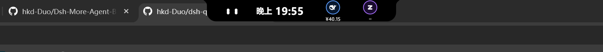

### 播放歌词、翻译与 AI logo

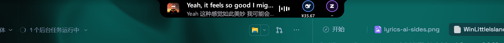

### 展开的音乐页面

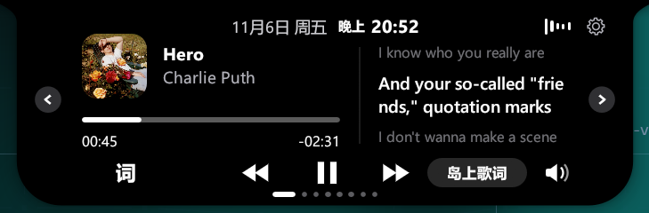

### WinLittleIsland 英文标识

## 桌面展示图

### 收起状态

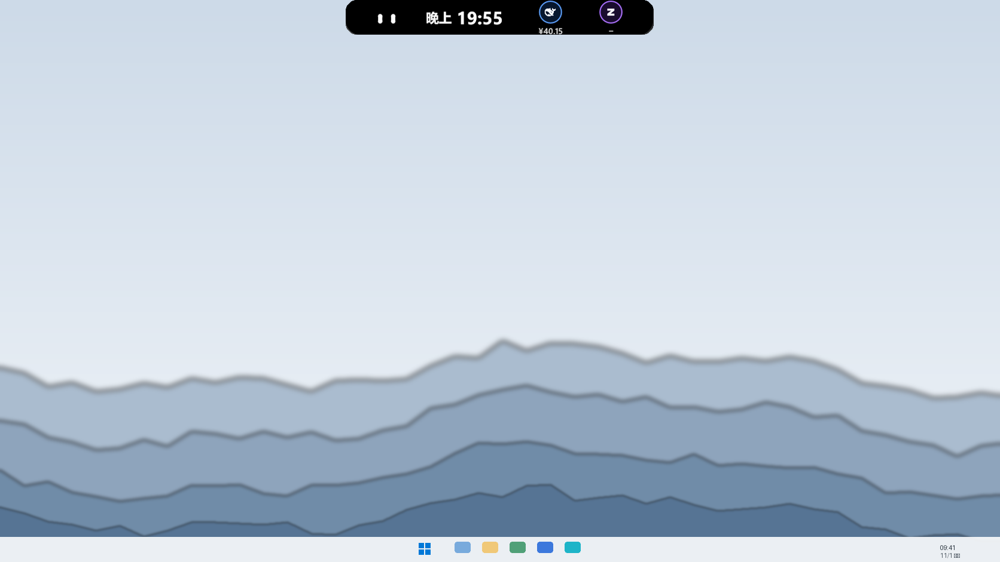

### 鼠标靠近后展开

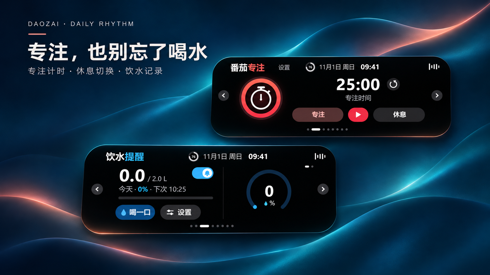

### 待办清单

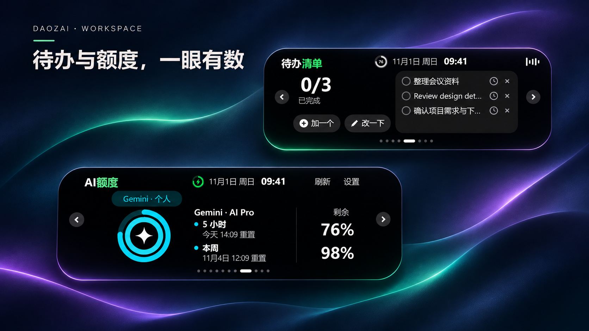

### 日程提醒

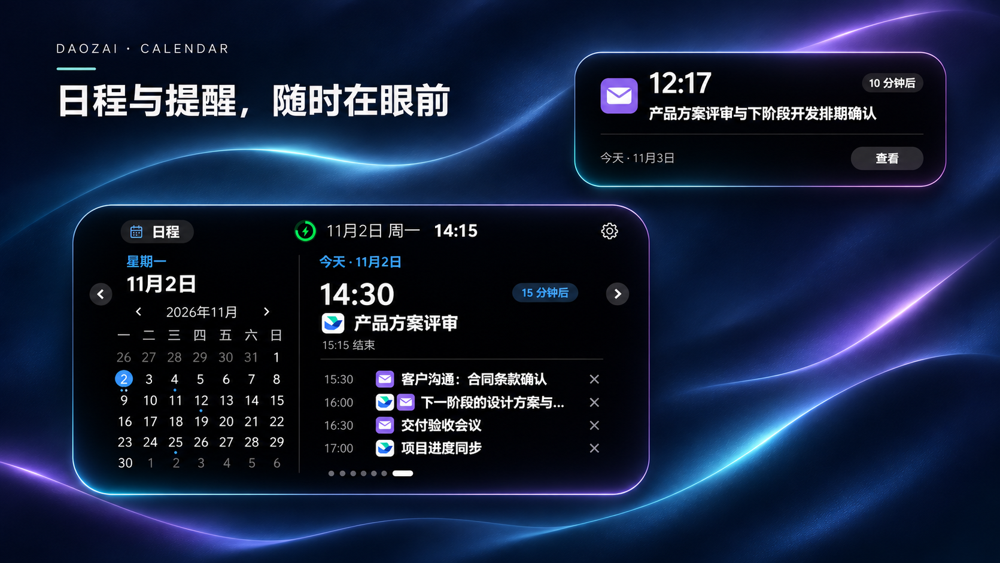

## 功能截图

### AI 额度

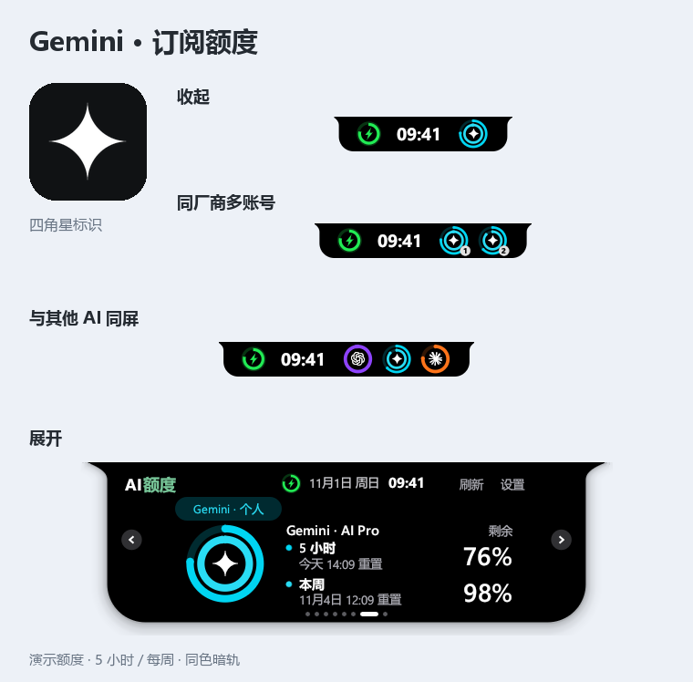

### 音乐与歌词

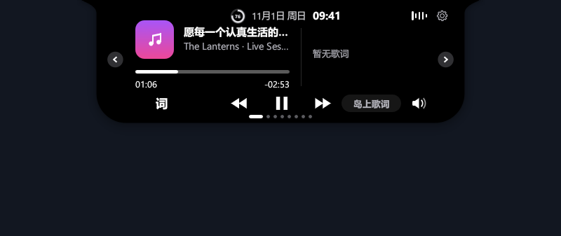

### 专注

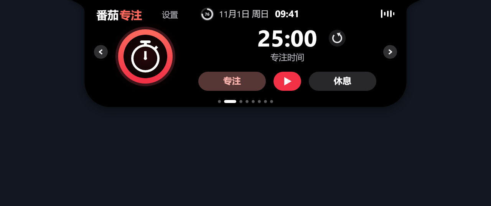

### 日历

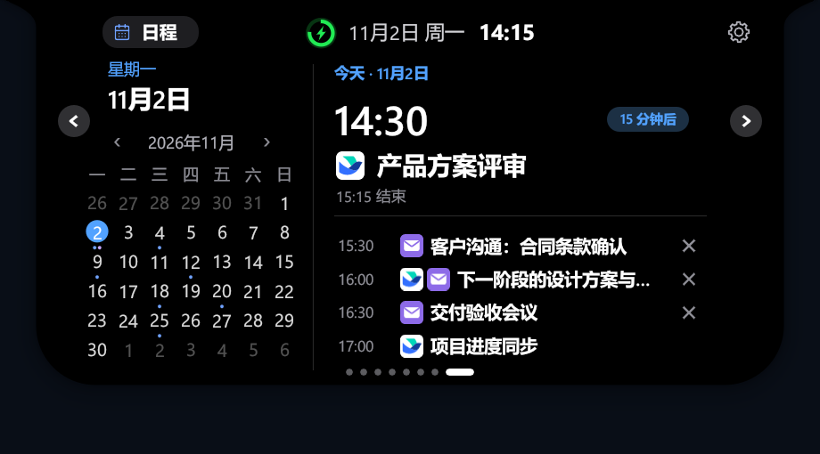

### 待办

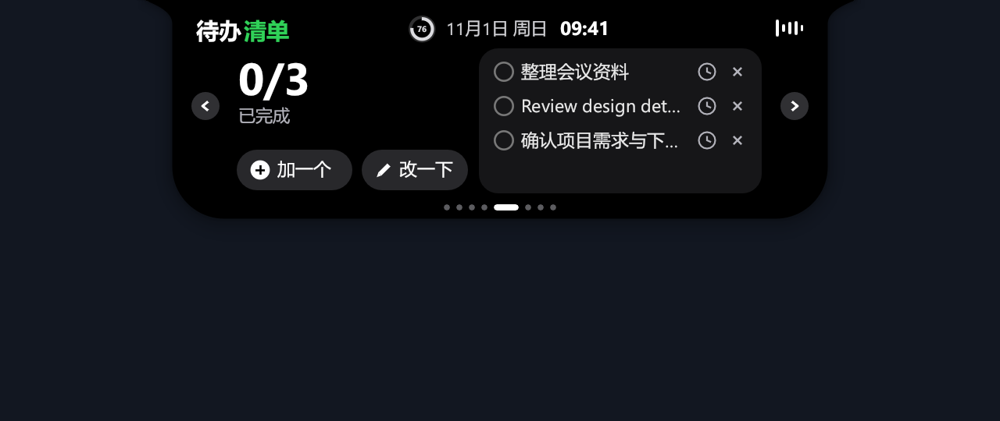

### 饮水

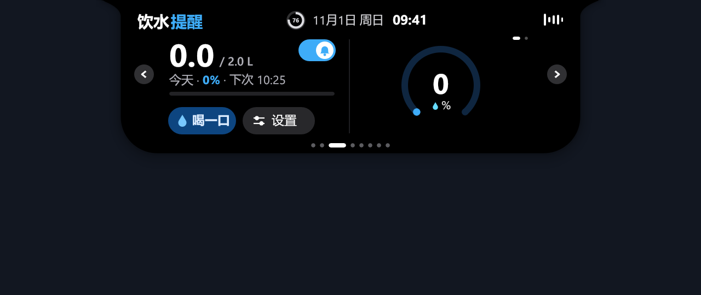

### 提醒

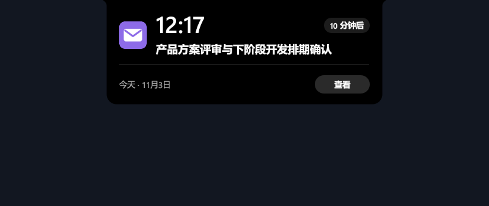

### 极简岛

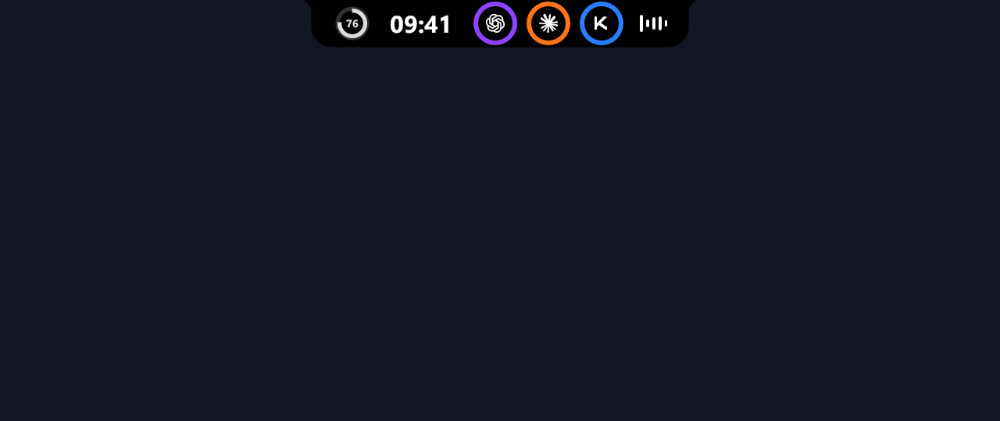

## 图片来源说明

- 本页以及 `docs/images/` 下的图片仅用于 WinLittleIsland 项目展示，不包含第三方项目截图或他人仓库素材。
- 新截图统一放在 `docs/images/current/`，历史展示图保留在 `docs/images/` 下。
- 提交新截图前请遮挡账号、验证码、私人日程等敏感信息。
